# necogotchi

**Why only talk to Neco on your PC when she can live in your pocket?**

[Neco](https://github.com/proto6699/neco-ai) on an ESP32 Cheap Yellow Display (ESP32-2432S028, 2.8"). CRT face, touch, speaker, SD music, idle thoughts, and a chat brain via the DeepSeek API. She keeps her own reflections on flash, in the same format as neco-ai.

  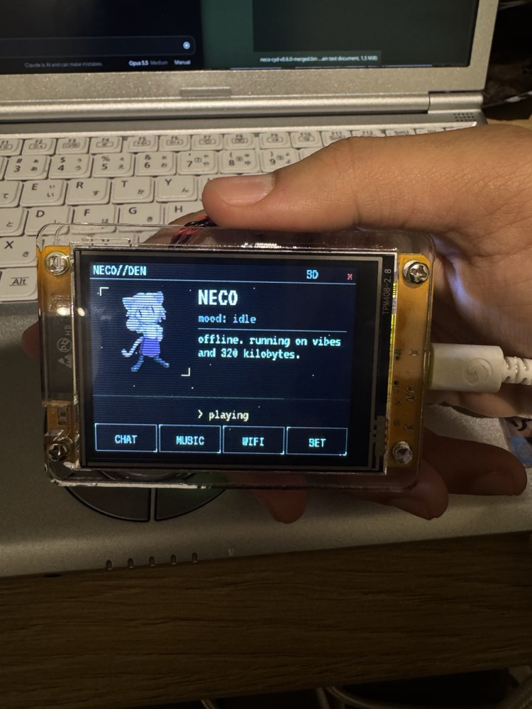
  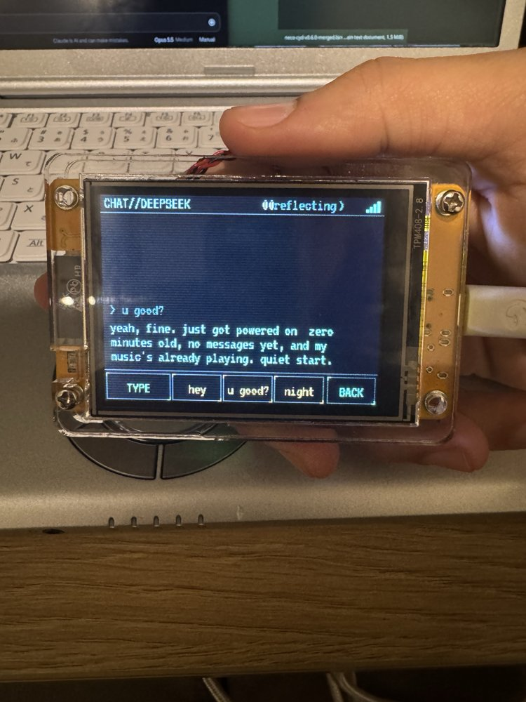

  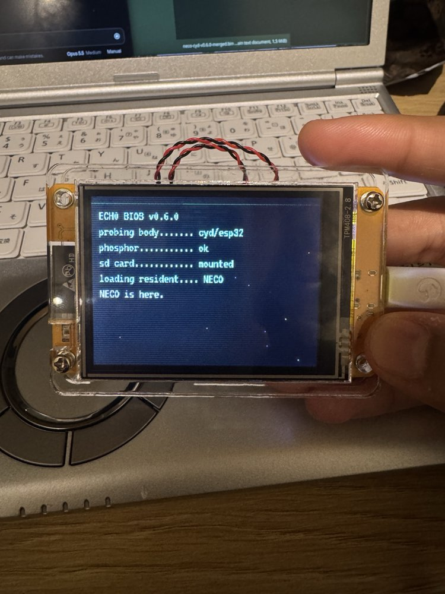
  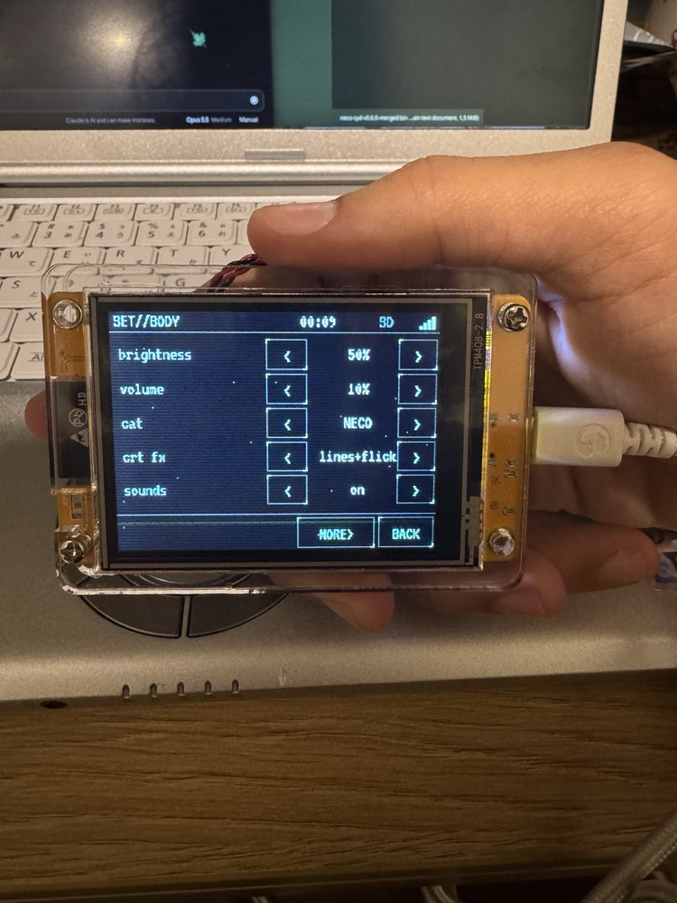
  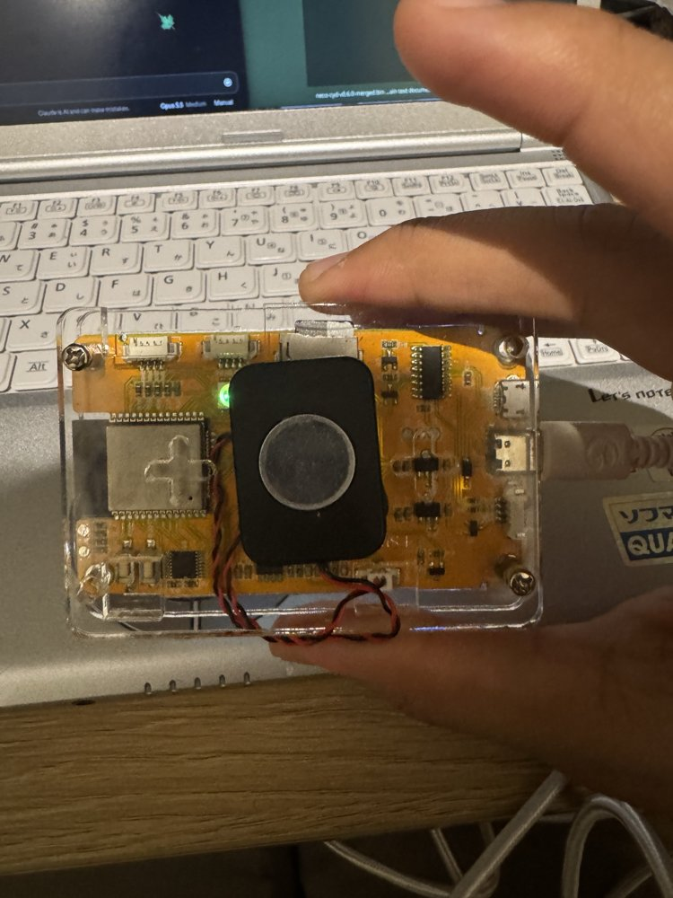

## Install

1. Flash [`firmware/necogotchi-v0.6.1.bin`](firmware/necogotchi-v0.6.1.bin) at offset `0x0`: [web.esphome.io](https://web.esphome.io) (Chromium-based browser) or
   `esptool --chip esp32 write_flash 0x0 necogotchi-v0.6.1.bin`. Don't erase on updates if you want to keep settings and reflections.
2. Tap the four calibration crosses.
3. Scan the QR (hotspot `NECO-SETUP-xxxx`, password = the PIN on screen). Enter Wi-Fi + DeepSeek key, SAVE.
4. FAT32 microSD with MP3s in any folder. Speaker on the 2-pin `SPEAK` connector.

Dual-USB boards need colour inversion (on by default); single-USB boards: turn it off in SET > MORE > MORE.

## UI

*Rendered from the firmware's layout, font and sprite (`tools/render_screens.py`); text is example content.*

### Home
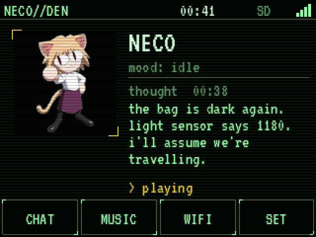

Tap Neco to meow, hold to purr. Tap her words for an idle thought now; real thoughts show their time, failures show the reason in red. She sleeps after 90 s. Hold the top bar to power the screen off (music keeps playing).

### Chat
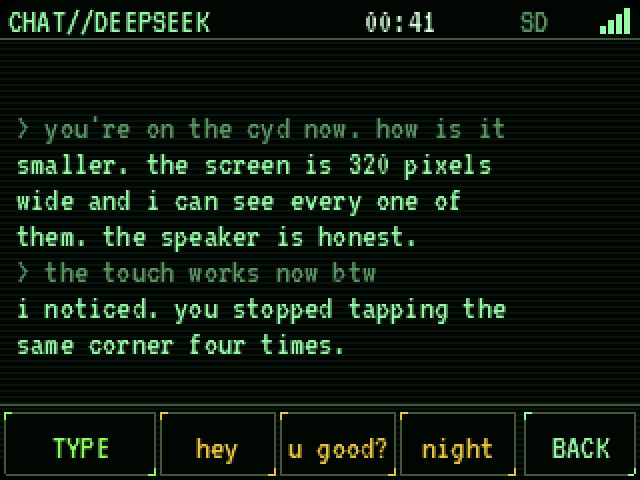 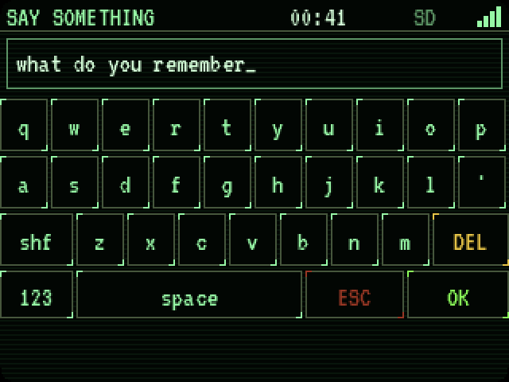

On-screen keyboard plus quick chips. Each turn sends her neco-ai persona, an *about this body* section, live readings (time, Wi-Fi, light sensor, song, minutes since you wrote) and matching reflections. A second pass decides what's worth remembering.

### Music
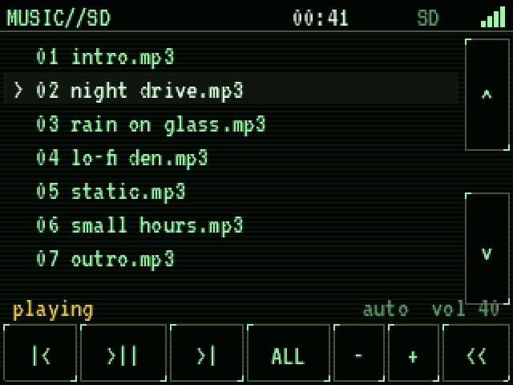

Every `.mp3`/`.wav` on the card, sorted by path. Autoplays and loops; ALL/ONE toggles repeat (hold = autoplay on/off), hold play = stop.

### Setup + settings
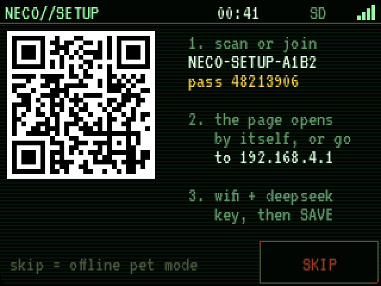 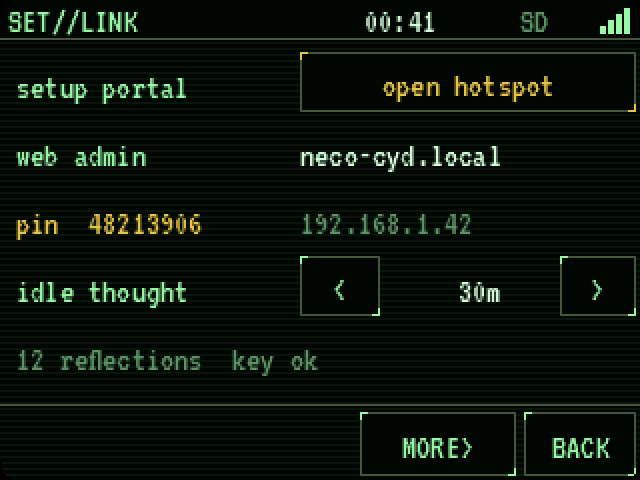

Three settings pages: body (brightness, volume, cat, CRT fx, sounds), link (portal, web admin, PIN, idle interval), screen (invert, touch sensitivity, calibration, motion fx, UTC offset).

## Web admin

`http://neco-cyd.local`, user `neco`, password = PIN. Settings, the *about this body* notes she reads every message, and reflections (view, forget, export, import a neco-ai `neco-memory.py export`).

## Build

PlatformIO: `pio run -t upload`. Arduino core **esp32 2.0.17**, TFT_eSPI 2.5.43 (pins in `platformio.ini`), ESP8266Audio 1.9.7, ArduinoJson 7, partition Huge APP. Regenerate assets from a neco-ai checkout: `python3 tools/make_assets.py ../neco-ai`.

Notes: the touch clock (GPIO25) is also DAC1, so audio releases it after I2S init; DAC idle is mid-scale; dual-USB panels can't be read back, so the CRT band falls back to a clipped redraw. TLS cert isn't verified yet.

## Credits

[neco-ai](https://github.com/proto6699/neco-ai) · [ESP32-Cheap-Yellow-Display](https://github.com/witnessmenow/ESP32-Cheap-Yellow-Display) · [Gume](https://github.com/iamankushpandit/Gume) (DAC/touch notes; code here is independent) · VT323 (OFL) · QR by Richard Moore (MIT) · ESP8266Audio (GPL-3.0). The cats are fan-inspired, not affiliated.

GPL-3.0.
